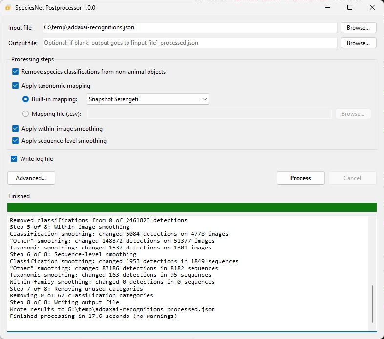
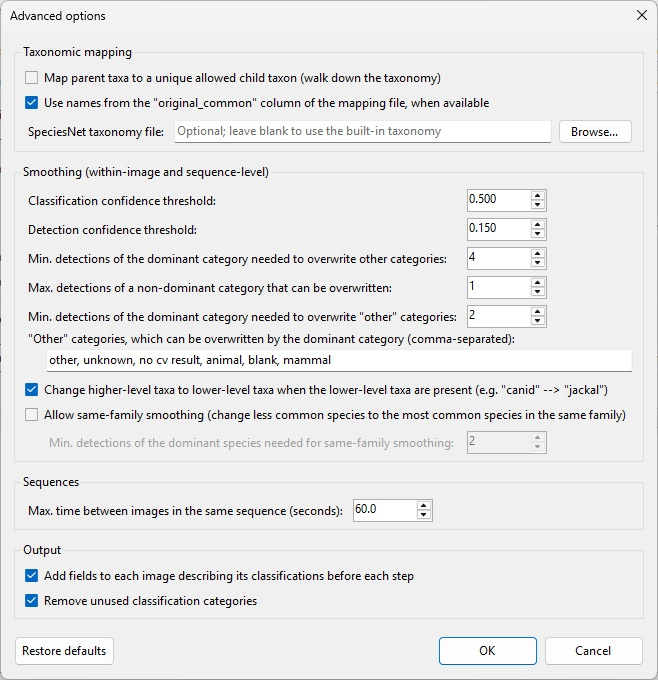

# SpeciesNet Postprocessor

SpeciesNet Postprocessor is a simple Windows program that cleans up [SpeciesNet](https://github.com/google/cameratrapai) species classifications in a [MegaDetector-formatted results file](https://lila.science/megadetector-output-format), for example a file produced by [AddaxAI](https://addaxdatascience.com/addaxai/). It does the same postprocessing that MegaDetector's [manage_local_batch.py](https://github.com/agentmorris/MegaDetector/blob/main/notebooks/manage_local_batch.py) notebook does after running SpeciesNet, without requiring Python:

* **Taxonomic mapping**: restricts classifications to a list of taxa that occur in your study area, and uses your preferred names for those taxa. Predictions of taxa that aren't on the list are mapped to the nearest taxon that is on the list (e.g. the genus or family), or to "animal".
* **Removing classifications from non-animal objects**: removes species classifications from objects that MegaDetector thinks are people or vehicles.
* **Within-image smoothing**: cleans up inconsistent classifications within an image, e.g. an image with 20 zebras and one horse is probably 21 zebras.
* **Sequence-level smoothing**: cleans up inconsistent classifications within a sequence (burst) of images, e.g. zebra/zebra/zebra/equus species/zebra is probably all zebras.

The output is a new results file in the same format, so it can be used anywhere the original file could be used. Fields that aren't part of the standard format (e.g. AddaxAI's "verified" field) are passed through unchanged.

## Table of contents

* [Running the program](#running-the-program)
* [Input file requirements](#input-file-requirements)
* [Taxonomic mapping files](#taxonomic-mapping-files)
* [Relationship to the MegaDetector Python code](#relationship-to-the-megadetector-python-code)
* [Building from source](#building-from-source)
* [Testing](#testing)
* [Screenshots](#screenshots)
* [License](#license)

## Running the program

SpeciesNetPostprocessor.exe is a single file that runs on 64-bit Windows; there's nothing to install. Double-click it, then:

* Choose an **input file** (the .json file from AddaxAI, or from MegaDetector/SpeciesNet). You can also drag a file onto the window.
* Optionally choose an **output file**. If you leave this blank, results are written next to the input file, e.g. c:\images\results.json is processed to c:\images\results_processed.json.
* Choose which processing steps to run (by default, all of them).
* If you're applying a taxonomic mapping, choose a **built-in mapping** (currently just "Snapshot Serengeti") or a **mapping file** (.csv).
* Click **Process**.

If "Write log file" is checked (the default), debugging information is written to a .txt file next to the output file (e.g. results_processed.txt). If something goes wrong, this is the file to send to whoever supports this program.

Settings are remembered between runs (in %APPDATA%\SpeciesNetPostprocessor\settings.json). The "Advanced..." button opens a dialog with less commonly-used settings for taxonomic mapping and smoothing; that dialog has a "Restore defaults" button. All default settings match the defaults in manage_local_batch.py.

## Input file requirements

The input file should be a [MegaDetector-formatted results file](https://lila.science/megadetector-output-format) that includes SpeciesNet classifications.

Taxonomic mapping requires the "classification_category_descriptions" field, which SpeciesNet results always include. If some categories are missing descriptions (AddaxAI doesn't write descriptions for "blank", "animal", or "vehicle"), standard SpeciesNet descriptions are filled in, and this is noted in the log.

Sequence-level smoothing requires image timestamps, in either of these fields for each image (if both are present, the first is used):

* exif_metadata/DateTimeOriginal: written by AddaxAI, and by MegaDetector when run with --include_exif_tags
* datetime: written by MegaDetector when run with --include_image_timestamp

Timestamps should be in EXIF format (e.g. "2022:12:01 09:17:12"); ISO-8601 timestamps (e.g. "2022-12-01T09:17:12") are also accepted. Each folder is treated as a camera, except that common camera overflow folders (e.g. 100RECNX, 101MEDIA) are treated as part of their parent folder. Images from the same camera that are 60 seconds apart or less are treated as the same sequence. Images without a valid timestamp are treated as single-image sequences. If no images have a valid timestamp, processing stops with an error, unless sequence-level smoothing is turned off.

## Taxonomic mapping files

A taxonomic mapping file is a .csv file with at least the columns "latin" (a latin name from the SpeciesNet taxonomy: a species binomial like "equus quagga", or a genus, family, order, or class) and "common" (the name to use for that taxon in the output). If an "original_common" column is present, names from that column are used instead of names from the "common" column (this can be changed in the advanced options). Rows with no latin name are ignored. If the same latin name appears more than once, the first row is used. See [snapshot_serengeti_speciesnet_20251031.csv](src/SpeciesNetPostprocessor.Core/Resources/snapshot_serengeti_speciesnet_20251031.csv) for an example.

Mapping uses the SpeciesNet taxonomy file to look up relationships between taxa. The program includes the taxonomy file from the SpeciesNet v4.0.3a model package, which is also what [https://lila.science/speciesnet-taxonomy-file](https://lila.science/speciesnet-taxonomy-file) points to; a different taxonomy file can be selected in the advanced options.

## Relationship to the MegaDetector Python code

The processing code is a line-by-line port of the relevant functions in the [MegaDetector Python package](https://github.com/agentmorris/MegaDetector), primarily restrict_to_taxa_list(), remove_classifications_from_non_animal_detections(), smooth_classification_results_image_level(), and smooth_classification_results_sequence_level() in [classification_postprocessing.py](https://github.com/agentmorris/MegaDetector/blob/main/megadetector/postprocessing/classification_postprocessing.py), plus the sequence-building code in read_exif.py and cct_json_utils.py. Steps run in the same order as in manage_local_batch.py: taxonomic mapping, removing classifications from non-animal objects, within-image smoothing, sequence-level smoothing, and removing unused classification categories.

Output files are written in exactly the format MegaDetector's write_json() uses, and for files the Python code can process, the output of this program is byte-for-byte identical to the output of the Python code with the same settings. The only intentional differences are cases where the Python code would fail:

* Missing classification category descriptions are filled in (see above).
* Human, blank, animal, vehicle, and "no cv result" categories are recognized by their taxonomic tokens, rather than by an exact match that includes the SpeciesNet GUID (AddaxAI writes common names in place of GUIDs).
* Classifications that aren't sorted by confidence are sorted, rather than causing an error.
* Taxa that aren't in the SpeciesNet taxonomy are mapped by walking up the taxonomy (with a warning in the log), rather than causing an error.
* Descriptions that aren't lowercase are converted to lowercase.
* The taxonomy file is always read as UTF-8.

## Building from source

The program is written in C# for .NET 10. To build it, install the [.NET 10 SDK](https://dotnet.microsoft.com/download/dotnet/10.0), then run:

`dotnet build SpeciesNetPostprocessor.slnx -c Release`

This will build to `src/SpeciesNetPostprocessor/bin/Release/net10.0-windows/SpeciesNetPostprocessor.exe`.

On my machine, where .NET 9 is still the default, use:

`%LOCALAPPDATA%\Microsoft\dotnet\dotnet build SpeciesNetPostprocessor.slnx -c Release`

To create the standalone, single-file .exe (which doesn't require .NET to be installed):

`dotnet publish src/SpeciesNetPostprocessor -p:PublishProfile=win-x64 -o publish`

This will build to `publish/SpeciesNetPostprocessor.exe`.

On my machine, where .NET 9 is still the default, use:

`%LOCALAPPDATA%\Microsoft\dotnet\dotnet publish src/SpeciesNetPostprocessor -p:PublishProfile=win-x64 -o publish`

The solution contains three projects:

* **SpeciesNetPostprocessor.Core**: all of the processing code (no UI), including the built-in mapping and taxonomy files (in Resources).
* **SpeciesNetPostprocessor**: the Windows Forms application.
* **SpeciesNetPostprocessor.Cli**: a command-line interface to the same processing code, mostly used for testing. Run it with --help for usage information; --write-default-options writes an options file (using the same option names as the Python code) that can be edited and passed back with --options.

## Testing

The [tests](tests) folder contains scripts that check that this program's output is identical to the output of the MegaDetector Python code, on real results files and on randomly-generated results files, and that edge cases the Python code can't handle are handled sensibly. There's also a script for smoke-testing the GUI. See [tests/README.md](tests/README.md) for details.

## Screenshots

 

## License

This repository is licensed with the [MIT license](LICENSE).